# Lok Sabha Q&A Pipeline: Architecture and Design

**Status:** living document. Sections marked _Planned_ describe work that is designed but not yet merged.

**Audience:** engineers reviewing or extending the pipeline, and anyone who wants the shape of the system without reading the code.

---

## 1. What this is

Kartvya is building a knowledge graph of what the Indian Union Government says about itself: schemes, beneficiaries, budgets, metrics, regions, officials. The richest public, structured, and regularly published source of such statements is the written answers ministers give to questions in the Lok Sabha. Every sitting day produces a few hundred question-and-answer PDFs, each with a predictable structure: header, numbered sub-questions, a minister's answer, and often a statement with tables and annexures.

This repository is the ingestion and extraction pipeline that turns those PDFs into reviewed, structured text and tables, ready for entity annotation and graph construction. It is a single-operator, single-machine system by design. The hard problems are not throughput; they are extraction quality, table fidelity, and keeping 25,000 documents in a knowable state while a human works through them.

### What it does today

1. Pulls the per-session question listing from sansad.in and downloads every question PDF into a ministry-organised folder tree.
2. Extracts text locally with Marker and detects where tables are with Camelot.
3. For documents with tables, splits the PDF into pages, detects multi-page tables, and extracts each table as JSON with a vision LLM.
4. Tracks every document through an explicit state machine persisted next to the document.
5. Exposes the result to an operator through a CLI and to review tooling through two small HTTP APIs.
6. Has begun manual entity annotation on top of the extracted text, which is the first step toward the knowledge graph.

### What it does not do yet

Chunking, entity resolution, and graph construction. Those are the destination; see section 11.

---

## 2. Scale

| Lok Sabha / Session | Question folders | PDFs       | Ministries | Current state    |
| ------------------- | ---------------- | ---------- | ---------- | ---------------- |
| 17 / I              | 6,189            | 6,188      | 55         | LOCAL_EXTRACTION |
| 17 / II             | 4,746            | 4,746      | 54         | LOCAL_EXTRACTION |
| 18 / II             | 3,500            | 3,499      | 55         | LOCAL_EXTRACTION |
| 18 / III            | 4,749            | 4,749      | 55         | LOCAL_EXTRACTION |
| 18 / IV             | 6,248            | 6,248      | 55         | LOCAL_EXTRACTION |
| **Total**           | **25,432**       | **25,430** |            |                  |

Roughly 6 GB of PDFs and extracted text across the five data repositories. Download failures are in the single digits per session. Documents average about three pages. Measured over all 25,430 state files: 42% of documents have at least one page with a detected table, and 21% have tables on consecutive pages, which is the candidate set for multi-page table handling. The LLM table-extraction stage was exercised on a few hundred documents during development; in the current data one document sits at LLM_EXTRACTION and one has manual entity annotations.

Everything runs on one machine. LLM calls use free-tier Gemini quotas rotated across a handful of API keys. The binding constraint has always been LLM quota and human review time, never CPU or I/O.

---

## 3. System overview

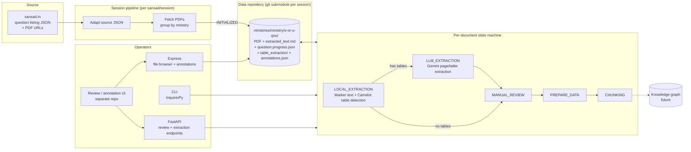

Three ideas carry the whole design:

- **The filesystem is the database.** Every artifact for a question lives in that question's folder, and the folder tree is a git repository. There is no separate metadata store.
- **The document is the unit of state.** Each folder carries a `question.progress.json` that says exactly where that document is and how it got there. Every tool reads and writes that file; nothing else coordinates them.
- **The pipeline is a state machine over documents.** Each processing stage is a transition. The orchestrator is a loop over documents in a given state.

---

## 4. Repository and data layout

### Repositories

```
kartvya.data-pipeline/                 parent repo: submodule manifest + helper scripts
└── repos/
    ├── code/loksabha/                 this repository (pipeline.loksabha-qna)
    └── data/loksabha-qna/
        ├── 17/i/                      one git submodule per sansad/session
        ├── 17/ii/
        ├── 18/ii/
        ├── 18/iii/
        └── 18/iv/
```

The code resolves the data root relative to a `.project-root` marker: two directories up from the code repo, then `data/loksabha-qna`. See `apps/py/utils/project_root.py`.

### One session

```
18/iv/
├── 18_iv.qna.source.json                         raw listing from sansad.in
├── sansad-session-pipeline-logs/
│   ├── progress-status.json                      iterations of the session pipeline
│   └── 1.STEP_1_PARTIAL_Fetch Questions PDFs.log.json   full output of one step
└── ministries/
    └── health-and-family-welfare/                kebab-cased ministry name
        └── s-64/                                 s = starred, u = unstarred, then question number
            ├── AS64_LZHVFr.pdf                   original PDF
            ├── extracted_text.md                 Marker output, page-delimited
            ├── question.progress.json            the state file (section 5)
            ├── table_extraction/                 only if LLM extraction ran
            │   ├── page_3.md                     per-page text from the LLM
            │   ├── page_3_tables.json            per-page tables from the LLM
            │   └── multi_page_table_3_5.json     one table spanning pages 3 to 5
            └── annotations.json                  manual entity annotations (section 7.4)
```

The `s-`/`u-` prefix exists because starred and unstarred questions share a number space; early runs collided when the folder was just the number.

### Why this layout

- **Locality.** Everything about a document is in one place. A reviewer, a script, or `ls` can find it without a lookup.
- **Git as audit and undo.** Data is committed per ministry. A bad extraction run is one `git checkout` away from being reverted, and the commit log is the processing history.
- **Submodule per session.** Sessions are independent units of work and of size (about 1 GB each). Splitting them keeps clones and pushes bounded and lets a session be added or retired without touching the others.

Trade-offs are discussed in section 9.

---

## 5. The document state machine

### States and transitions

The transition table in `apps/py/types/models.py` declares these edges and guards:

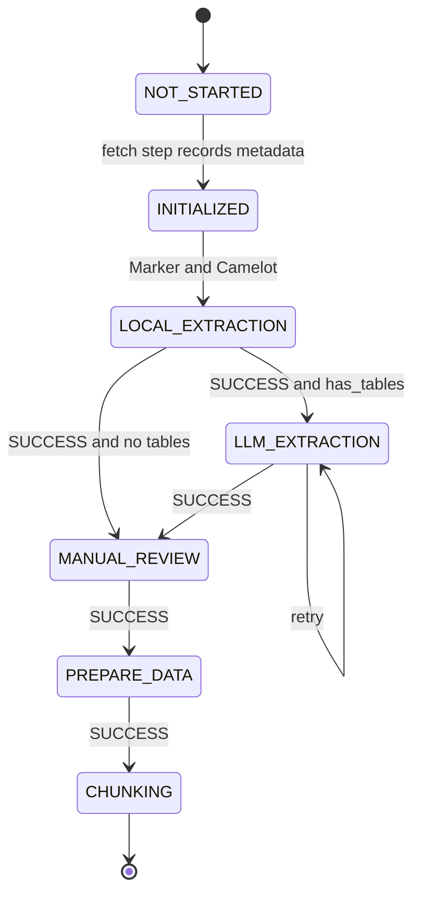

PREPARE_DATA and CHUNKING are *Planned*.

| State            | Who performs it                | Payload stored in the entry                                                           |
| ---------------- | ------------------------------ | ------------------------------------------------------------------------------------- |
| NOT_STARTED      | state manager on file creation | none                                                                                  |
| INITIALIZED      | session pipeline fetch step    | question metadata: number, subject, members, ministry, type, date, PDF paths          |
| LOCAL_EXTRACTION | CLI "Extract Text"             | per-page text and table flags, Camelot table metadata, document totals                |
| LLM_EXTRACTION   | CLI "Fix Tables" or API        | per-page text and tables from the LLM, multi-page table files, success/failure counts |
| MANUAL_REVIEW    | reviewer, through the review UI's save, which enters this state from LOCAL_EXTRACTION or LLM_EXTRACTION via the cleaned-data endpoint | per-page corrected text and tables, flags, edit tracking |
| PREPARE_DATA     | _Planned_                      | normalised payload for chunking                                                       |
| CHUNKING         | _Planned_                      | chunk paths and strategy                                                              |

Each entry also carries a `status` of SUCCESS, FAILED, or PARTIAL. A FAILED entry is a legitimate state: the document is at LLM_EXTRACTION with status FAILED, and the retry self-transition is how it moves on.

### The state file is an event log

`question.progress.json` holds an append-only list of entries rather than a map of state to data:

```json
{
  "current_state": "LOCAL_EXTRACTION",
  "states": [
    {
      "state": "NOT_STARTED",
      "status": "SUCCESS",
      "timestamp": "...",
      "data": {},
      "meta": { "auto_generated": true },
      "errors": []
    },
    {
      "state": "INITIALIZED",
      "status": "SUCCESS",
      "timestamp": "...",
      "data": { "question_number": 64, "...": "..." },
      "meta": {},
      "errors": []
    },
    {
      "state": "LOCAL_EXTRACTION",
      "status": "SUCCESS",
      "timestamp": "...",
      "data": { "pages": { "1": { "has_tables": false, "text": "..." } }, "has_tables": false, "total_tables": 0 },
      "meta": {},
      "errors": []
    }
  ],
  "created_at": "...",
  "updated_at": "..."
}
```

Consequences:

- `current_state` is a projection; the list is the truth.
- A retry appends a second LLM_EXTRACTION entry instead of overwriting the first, so a failed attempt's error is never lost.
- Rollback appends a rollback entry instead of deleting later states, so history survives operator intervention.
- `meta` is the slot for audit fields: transition reason and trigger source enums exist in the type model for this.

The previous dict-shaped format did overwrite on retry and did delete on rollback. The migration across all 25,000 files was done with a script that backs up, converts, and verifies each file (`scripts/migrate-progress-file-format.ts`).

### Layering

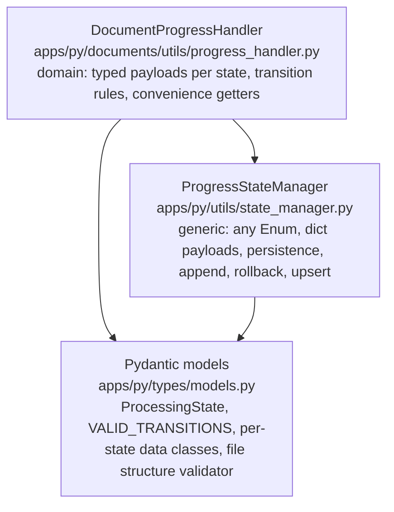

The state manager knows nothing about documents. It takes an enum and dicts, and validates only the file skeleton. The handler owns the vocabulary: which states exist, what each entry must contain, which transitions are legal. This split exists so the same manager can later run an approval flow or a ministry-level pipeline without modification.

### Validation that is enforced today

- The file validator rejects a `current_state` with no entry and rejects any entry for a state later than `current_state`.
- A transition is refused unless the (from, to) edge appears in `VALID_TRANSITIONS`.
- Every payload is a typed Pydantic model and is validated on write.

### Validation that is declared but not yet enforced

`VALID_TRANSITIONS` declares guards on edges: "requires status SUCCESS", "requires has*tables". The validator is currently called without the current entry's data, so only edge existence is checked. The guards are honoured by the callers, which check status and table presence before asking for a transition. Moving that evaluation into the validator is \_Planned* (section 10).

---

## 6. Session pipeline

The session pipeline runs once per sansad/session and does the two batch steps that are not per-document: adapt the source listing and fetch the PDFs.

- **Adapt.** Read `<sansad>_<session>.qna.source.json`, validate each record with a Pydantic model, normalise to the internal `ParliamentQuestion` shape.
- **Fetch.** Group questions by ministry, create the folder tree, download each PDF with timeout and retry, skip files that already exist, and perform the INITIALIZED transition on the document's state file. Failures are collected rather than aborting the step, and the step reports PARTIAL if any failed.

A small step runner (`apps/py/pipeline/pipeline.py`) persists each step's full output to a log file and keeps an iteration index. If a previous iteration completed every step, the runner returns the last output without rerunning. This predates the document state machine and is deliberately simpler: two steps, rarely rerun, no branching.

The pipeline was first written in TypeScript and ported to Python once the extraction tooling settled in Python. The TypeScript version remains for reference.

---

## 7. Document processing stages

### 7.1 Local extraction

Operator: CLI → PDF Tools → Extract Text from PDF. Select sansad, session, and ministries; documents already at LOCAL_EXTRACTION with SUCCESS are skipped.

Per document:

1. **Text** via Marker (`marker-pdf`), configured for Markdown output with page separators. The output is split on the `{N}----` markers into per-page text.
2. **Table detection** via Camelot in lattice mode across all pages. Only metadata is kept per table: page, accuracy score, row and column counts. Camelot's cell contents are discarded (see decision D4).
3. Build the LOCAL_EXTRACTION payload: per-page `has_tables`, `num_tables`, text; document-level totals computed by a model validator.
4. Save `extracted_text.md` atomically (temp file then move) and transition the state file.

Marker runs its layout models on the CPU; this stage costs no API calls and is the one that has been run across all 25,000 documents.

### 7.2 LLM table extraction

Operator: CLI → PDF Tools → Fix Tables Using AI, or `PATCH /api/knowledge-graph/llm-extraction`. Candidates are documents at LOCAL_EXTRACTION with SUCCESS and at least one table page.

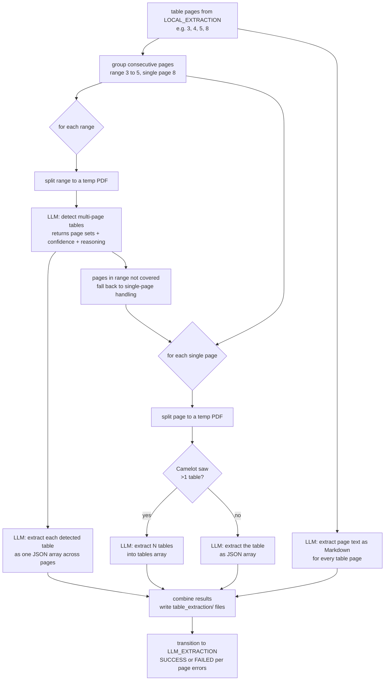

Key properties:

- **Pages, not documents, go to the LLM.** Each call sees one page or one short range. This bounds prompt size, isolates failures to a page, and makes partial success meaningful.
- **Two-pass multi-page handling.** First ask whether a range contains a table that continues across pages, then extract only the detected span. Page numbers returned relative to the split PDF are re-based to the original document.
- **Camelot's count steers the prompt.** A page with two detected tables gets the "extract N distinct tables" prompt; otherwise the single-table prompt.
- **Structured output by prompt, parsed defensively.** Prompts demand JSON only; the parser strips code fences and keeps the raw response on parse failure so a reviewer can see what the model said.
- **Key rotation.** `KeyManager` loads `GEMINI_API_KEY` and `GEMINI_API_KEY_1..N` from the environment and hands out keys round-robin. `UsageTracker` writes a daily per-key report to `reports/api_usage/`. The model is `gemini-2.0-flash`.

Outputs are written under `table_extraction/` and summarised in the LLM_EXTRACTION entry: per-page text and tables, a map of multi-page table files to the pages they cover, and success/failure counts.

### 7.3 Manual review

Reviewers correct text and tables page by page. The FastAPI service exposes:

| Method | Path                                        | Purpose                                                  |
| ------ | ------------------------------------------- | -------------------------------------------------------- |
| PATCH  | `/api/knowledge-graph/llm-extraction`       | run or retry LLM extraction for one document             |
| PATCH  | `/api/knowledge-graph/cleaned-data`         | save edited pages; on first use moves the document into MANUAL_REVIEW, seeding review pages from the latest extraction |
| GET    | `/api/knowledge-graph/cleaned-data`         | review progress: state, pages edited, pages reviewed     |
| PATCH  | `/api/knowledge-graph/manual-review/page`   | update one page's review data                            |
| PATCH  | `/api/knowledge-graph/manual-review/pages`  | update several pages                                     |
| PATCH  | `/api/knowledge-graph/manual-review/status` | set review status                                        |
| GET    | `/api/knowledge-graph/manual-review/status` | review status and data                                   |

The endpoints take a document path relative to the data root and delegate to the progress handler. They contain no state-machine logic themselves; the handler's upsert path lets a reviewer save page by page without a transition per save.

### 7.4 Entity annotation

The Express service (`api/ts/server.ts`) serves the data tree to a browser-based UI: directory listing, text files, PDF streaming, and batched file reads, all path-checked against the data root. It also has three annotation routes:

| Method | Path                               | Purpose                                                               |
| ------ | ---------------------------------- | --------------------------------------------------------------------- |
| GET    | `/annotations/documents?ministry=` | list documents in a ministry with state and whether annotations exist |
| GET    | `/annotations/document?p=`         | load a document's text and existing annotations                       |
| PUT    | `/annotations/document?p=`         | save `annotations.json`                                               |

An annotation file records character-offset spans over `extracted_text.md`:

```json
{
  "document": {
    "id": "s-64",
    "path": "18/iv/ministries/health-and-family-welfare/s-64",
    "subject": "Ayushman Bharat Cards"
  },
  "entities": [
    {
      "id": "e7",
      "text": "Ayushman Bharat - Pradhan Mantri Jan Arogya Yojana (AB-PMJAY)",
      "start": 838,
      "end": 899,
      "category": "program"
    },
    { "id": "e11", "text": "Rs. 5 lakhs per family per year", "start": 970, "end": 1001, "category": "benefit" },
    { "id": "e12", "text": "55 crore beneficiaries", "start": 1067, "end": 1089, "category": "citizen_attribute" }
  ]
}
```

The category set comes from the entity schema drafted in `prompts/pipeline-prompts/crews/tasks/`: ministries and departments, services, benefits, programmes, individual and group citizen attributes, metrics, officials, service-delivery nodes, domain issues, documents, and regions. Manual annotation is producing the gold examples that LLM annotation will be evaluated against.

### 7.5 Prepare data and chunking

_Planned._ PREPARE_DATA normalises the reviewed pages into a single payload; CHUNKING splits it for embedding and graph extraction. The states and payload types exist; no stage code does yet.

---

## 8. Components

| Component            | Location                                      | Responsibility                                                                                                         |
| -------------------- | --------------------------------------------- | ---------------------------------------------------------------------------------------------------------------------- |
| Step runner          | `apps/py/pipeline/`                           | session-level steps with persisted outputs and resume                                                                  |
| Parliament questions | `apps/py/parliament_questions/`               | adapt, fetch, discover documents by state, table statistics                                                            |
| Extractors           | `apps/py/documents/extractors/`               | Marker/Camelot local extraction; page splitting; range detection; Gemini table and text extraction; result combination |
| Progress handler     | `apps/py/documents/utils/progress_handler.py` | typed state transitions and review upserts for a document                                                              |
| State manager        | `apps/py/utils/state_manager.py`              | generic persisted state machine                                                                                        |
| Types                | `apps/py/types/`                              | Pydantic models for questions, states, payloads, transitions                                                           |
| LLM key management   | `apps/py/llm_api_key/`                        | key rotation, rate limiter, usage reports                                                                              |
| Gemini client        | `apps/py/utils/gemini_api.py`                 | prompts and parsing for the five extraction calls                                                                      |
| CLI                  | `cli/py/`                                     | interactive selection, extraction workflows, reports                                                                   |
| FastAPI              | `api/py/`                                     | review and extraction endpoints                                                                                        |
| Express              | `api/ts/`                                     | data browsing and annotation storage for the UI                                                                        |
| Temporal workers     | `workflows/`                                  | legacy cross-language launcher for the session pipeline                                                                |
| Scripts              | `scripts/`                                    | one-off data maintenance: format migration, deduplication, renames                                                     |
| Prompts              | `prompts/`                                    | entity schema and annotation prompt experiments                                                                        |

### CLI

`npm run start:cli`

- **PDF Tools → Extract Text from PDF**: local extraction for selected ministries, skipping done documents, with a ten-second cancel window per ministry.
- **PDF Tools → Fix Tables Using AI**: find table documents, show per-ministry table statistics, run LLM extraction for all, a ministry, or one document.
- **Reports → Overview / Ministry Breakdown / Document Details**: state and status counts, per-ministry matrices, per-document table with filters for tables, failures, or a specific state.

### Class structure

The Python code has about 110 classes. Most are Pydantic models; a dozen carry behaviour. The diagrams below are grouped by layer and show only the members that matter for understanding the relationships. Arrow conventions: a hollow triangle is inheritance, a filled diamond is composition (the owner constructs and holds the part), an open diamond is aggregation (holds references it did not create), a dotted arrow is a dependency (calls or constructs transiently), and a solid arrow is an association (holds a reference). Boxes marked `<<module>>` are plain modules of functions that act as services.

#### Session pipeline framework

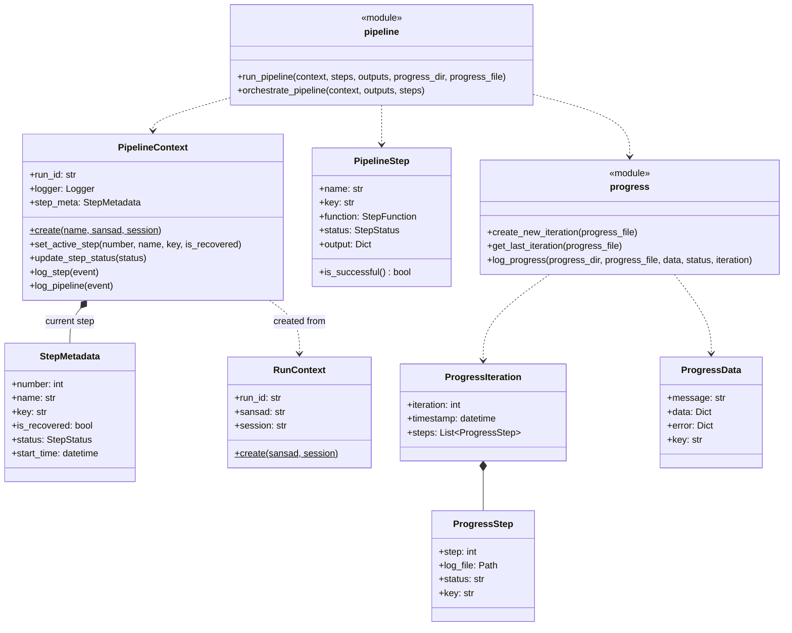

A step is a function plus metadata. The context is an in-memory object for one run: a run id, a logger that stamps every line with it, and the metadata of the step currently executing. Nothing here is persisted except through the progress module, which writes the iteration index and one log file per step.

#### Document state machine and persistence

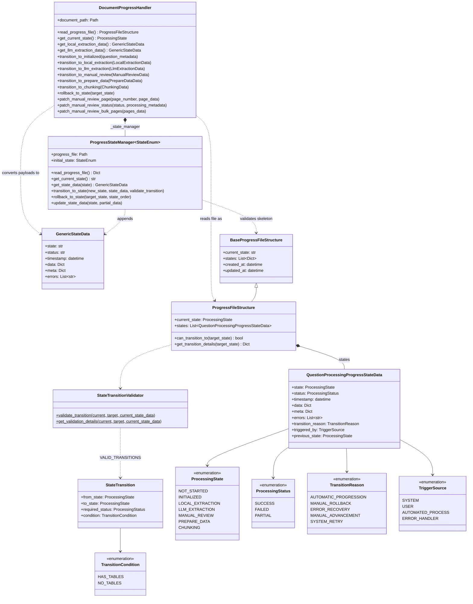

One state entry has three shapes depending on where it is. On the way in, a typed payload such as `LocalExtractionData` is converted by the handler into a `GenericStateData`, which is what the manager appends and persists. On the way out, the handler reads the whole file as a `ProgressFileStructure`, whose entries are `QuestionProcessingProgressStateData` with the audit fields. The manager never sees the typed payloads, which is what keeps it reusable for other state machines.

#### State payload models

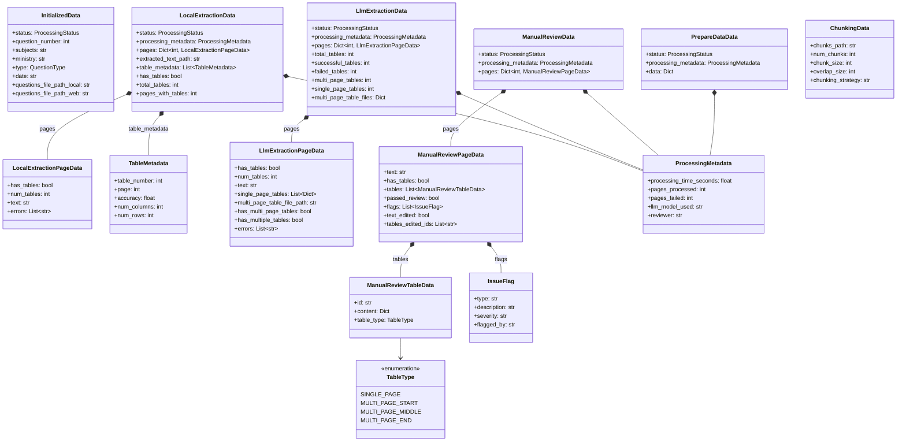

One payload class per state, each with the same spine: a status, processing metadata, and a per-page map. The per-page classes grow richer as a document moves right: local extraction knows whether a page has tables, LLM extraction holds the extracted tables, manual review adds edit tracking and flags. `InitializedData` is the `ParliamentQuestion` record copied into the state file so the document is self-describing.

#### Extraction

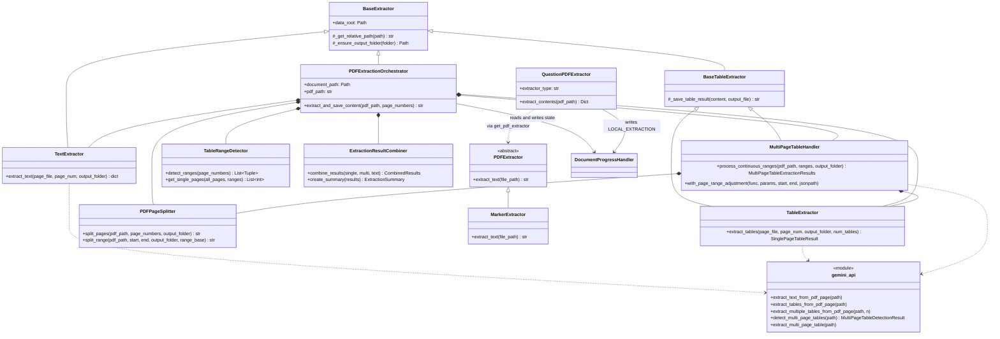

Two entry points, one per stage. `QuestionPDFExtractor` is local extraction: Marker through the `PDFExtractor` abstraction, Camelot called directly, one transition at the end. `PDFExtractionOrchestrator` is LLM extraction: it constructs its six collaborators in its own initialiser and sequences them. All LLM calls go through the `gemini_api` module, which the three extractor classes call as plain functions.

Results flow through their own small model family:

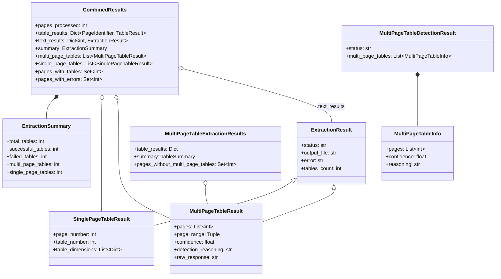

`PageIdentifier` is either a page number or a `(start, end)` tuple, so one dictionary holds both single-page and multi-page results. `CombinedResults` splits that dictionary into typed lists and page sets in its initialiser; that is where "which pages have tables" and "which pages failed" are decided.

#### LLM key management

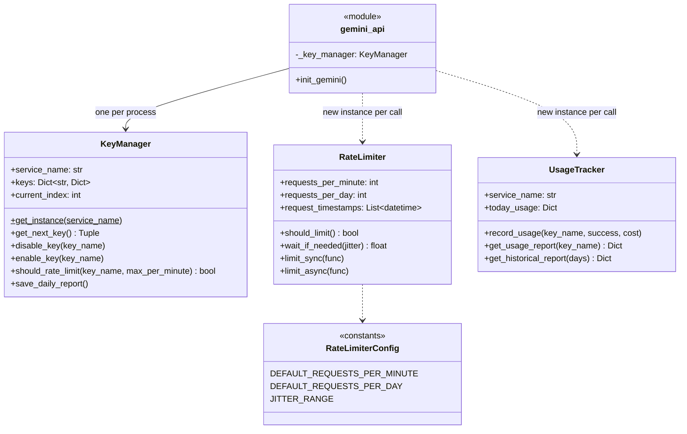

The lifetimes matter more than the shapes here. The key manager is a module-level singleton, so rotation state survives across calls. The rate limiter and usage tracker are constructed inside each call: the tracker reloads today's report from disk each time, which works, while the limiter starts with an empty window each time, which means it never limits. This is the gap listed in section 10.

#### Operator interfaces

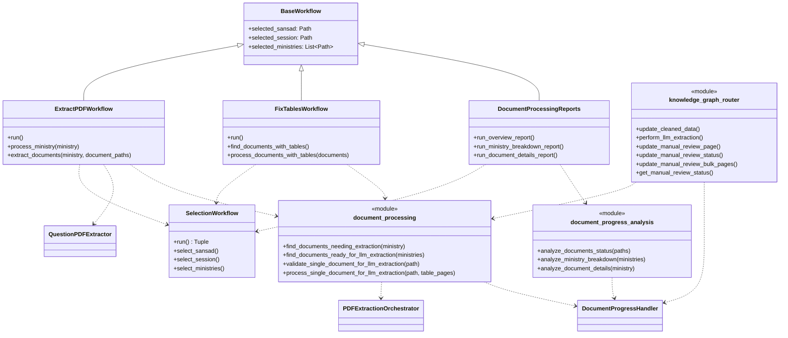

The CLI and the API are thin. Both delegate to the same two service modules, and both end at `DocumentProgressHandler`. The CLI workflows own only selection state and console output.

#### What the structure says

- **One write path.** Every component that changes a document's state, whether the fetch step, the two extractors, the CLI, or the API, goes through `DocumentProgressHandler`, and only the handler touches `ProgressStateManager`. Any cross-cutting fix to persistence, such as atomic writes or locking, has exactly one place to go.
- **Layering holds.** The state manager imports nothing from the document domain; the handler imports the manager and the models; extractors import the handler; interfaces import extractors and service modules. There are no upward imports.
- **Two context objects for two scopes.** `PipelineContext` is in-memory, per run, and about logging. `DocumentProgressHandler` is persisted, per document, and about state. They meet once, where the fetch step calls the handler to record INITIALIZED.
- **Composition without injection.** The orchestrator and the multi-page handler construct their collaborators in their own initialisers, and the extractors call `gemini_api` functions directly. Simple to read, but a test has to patch module functions rather than pass a fake. The service modules (`gemini_api`, `document_processing`, `document_progress_analysis`) are the natural seams to turn into injectable objects if that becomes necessary.
- **Inheritance is shallow and used for shared helpers only.** `BaseExtractor` and `BaseTableExtractor` provide path and file helpers; `BaseWorkflow` holds selection state. The one real abstraction is `PDFExtractor`, which exists so a second local text extractor could be swapped in.
- **Leftovers to clean up.** `api/py/schemas/pdf.py` describes the retired dict-shaped progress file and is not imported anywhere. `question_pipeline.py` and `QuestionPipelineState` belong to a per-question pipeline step that is commented out of the session pipeline. `PipelineConfig` is unused. Of the knowledge-graph exception family, only two are referenced, and only as caught types. The two `cleaned-data` endpoints predate the manual-review endpoints; they are now backed by a small adapter on the handler (`save_cleaned_pages`, `get_cleaning_progress`), which is also the only code path that moves a document into MANUAL_REVIEW.

---

## 9. Design decisions and trade-offs

Each entry: the decision, why, what was rejected, and what it costs.

### D1. Filesystem plus git as the database

**Decision.** Store every artifact in the document's folder; version the tree with git, one repository per session, committed per ministry.

**Why.** One operator, one machine, a few GB. Locality makes every document inspectable with ordinary tools. Git gives history, diff, and undo for free, and commit-per-ministry matches the granularity at which runs are launched and reverted.

**Rejected.** A relational store for metadata with blobs on disk. It would have added a second source of truth to keep in sync before the data model had settled.

**Cost.** Any aggregate question ("how many documents await review?") is a walk over N files. Fine at 25,000; a derived index becomes necessary before a UI needs it live. Git is slow on very large repositories; the per-session split keeps each under control. No concurrent-writer protection (see section 10).

### D2. The document as the unit of state, modelled as a state machine with an event log

**Decision.** Each document carries its own state file; processing stages are transitions; the file is an append-only log of entries.

**Why.** Visibility and operability at document granularity: the operator needs to see where a document is and act on it from any tool. The process genuinely is a sequence of data transformations with one branch (tables or not), one retry loop, and human steps interleaved with automated ones. A state machine expresses that; a step list does not. The log form was adopted after the map form lost retry errors and rollback history.

**Rejected.** A central job queue or workflow engine (see D7). A per-ministry or per-session state file, which would have made per-document retry and review awkward.

**Cost.** Aggregation requires scanning (D1). Transition guards are declared but enforced at call sites today (section 5).

### D3. A generic state manager under a domain-specific handler

**Decision.** Infrastructure (persistence, append, rollback, upsert) is enum-agnostic and dict-based; domain typing and transition rules live one layer up.

**Why.** The same mechanism is expected to serve other flows (approvals, ministry-level processing). Keeping Pydantic payload types in the domain layer means the manager never changes when a state gains a field.

**Cost.** Two places to read to understand one transition, and the generic layer validates less than it could.

### D4. Camelot detects; the LLM extracts

**Decision.** Run Camelot over every page but keep only where tables are and how big they are. Send only table pages to a vision LLM for cell extraction.

**Why.** Camelot is cheap, local, and good at saying "there is a ruled table here". Its cell output on these documents was unreliable: merged cells, multi-level headers, and tables continuing across pages produced misaligned rows. The LLM handles those cases and can be told the schema to emit. Using Camelot as a filter keeps LLM calls to the small fraction of pages that need them.

**Rejected.** Camelot or Marker tables as the final output (quality). LLM over every page (quota and cost, when free tiers were the budget).

**Cost.** Two tools to maintain. Camelot in lattice mode misses tables without ruling lines, and those pages then never reach the LLM. Accuracy scores are stored but not yet used to route borderline pages.

### D5. Page-level splitting and two-pass multi-page detection

**Decision.** Split PDFs to single pages or short ranges before each LLM call; ask first whether a range contains a continuing table, then extract the detected span.

**Why.** Bounded prompts, page-isolated failures, and a clear unit for partial success. Multi-page tables are common in annexures and are where naive page-by-page extraction loses rows and repeats headers.

**Cost.** More calls per document. Detection is itself an LLM judgement with a confidence score that is recorded but not yet thresholded. Pages at the edges of a range can hold a separate single-page table that the range pass does not look for.

### D6. Round-robin API keys with usage tracking

**Decision.** Load several free-tier keys from the environment, rotate per call, record per-key daily usage.

**Why.** Zero-budget experimentation. Free tiers are per key, so rotation multiplied the daily quota.

**Cost.** Rotation is not rate limiting. The per-call limiter is constructed fresh for each call, so it never sees prior calls and never waits (section 10). Keys are not disabled automatically on quota errors.

### D7. Temporal retired in favour of a CLI over the state files

**Decision.** Start with Temporal to coordinate a TypeScript workflow and Python activities; drop it once the pipeline was Python-only and the work became operator-driven.

**Why it was adopted.** The first pipeline was TypeScript; the extraction stack had to be Python. Temporal's per-language task queues let the two cooperate without an immediate rewrite.

**Why it was dropped.** The Python port took a week, after which the cross-language hop had no purpose. The workload shifted from "one batch per session" to "select, extract, fix, inspect, rerun", which is a console, not a durable workflow. Durability was already coming from the step runner and then the state files; Temporal was running with one attempt and a very long timeout, as a process launcher.

**Cost.** No automatic retries with backoff, no worker-level rate limiting, no concurrency, no workflow UI. Retries and limits are being added at the call site (section 10); reports replace the UI. At one machine and LLM-quota-bound throughput, concurrency was not the constraint.

### D8. Idempotency rather than resumption

**Decision.** A rerun skips any document whose target state already succeeded; a document that fails mid-way is redone from the start of its stage.

**Why.** Simple to reason about and to implement on top of D2. Stages are minutes per document at most.

**Cost.** Work inside a stage is lost on a crash. Acceptable at current stage durations.

---

## 10. Failure modes, what happened, and what covers them

| Failure                                         | Observed?                       | Mitigation today                                                                                                                                 | Gap                                                                                                            |
| ----------------------------------------------- | ------------------------------- | ------------------------------------------------------------------------------------------------------------------------------------------------ | -------------------------------------------------------------------------------------------------------------- |
| PDF download fails or times out                 | yes, single digits per session  | 5 retries with delay; failures collected and reported as PARTIAL; rerun skips existing files                                                     | failures were once double-listed when a retry later succeeded; fixed by a dedup script and better logging      |
| Starred and unstarred questions share a number  | yes                             | folder prefix `s-`/`u-`                                                                                                                          | one-off rename of existing folders                                                                             |
| Process dies mid-write of a state file          | yes, a few times                | reader fails loudly on invalid JSON; zero-byte files are re-initialised; git restores the last committed version; stage is idempotent and reruns | **write is not atomic** (_Planned_: temp file + fsync + rename)                                                |
| Two writers on one state file (CLI and API)     | not confirmed                   | none                                                                                                                                             | **no locking** (_Planned_: per-file lock)                                                                      |
| LLM returns non-JSON or wraps JSON in fences    | yes, regularly                  | fence stripping; raw response kept in the error result; page marked failed; retry via self-transition                                            | no automatic retry; a single transient error fails the page until an operator reruns                           |
| LLM rate limit or quota exhausted               | yes                             | key rotation; per-key usage reports                                                                                                              | **limiter never engages** (_Planned_: one limiter per key held by the key manager; bounded retry with backoff) |
| Provider retires the pinned model name          | yes, twice                      | model name read from `GEMINI_MODEL`, default is the lite tier that answers on the free quota                                                     | no automatic fallback between models                                                                           |
| Key numbering has a gap, rotation silently shrinks to one key | yes                | numbered keys are discovered by scanning the environment, not by counting up from 1                                                              | none                                                                                                           |
| Limiter compares naive and aware datetimes, every table call throws | yes         | all limiter timestamps are UTC-aware                                                                                                             | the limiter is still constructed per call, see above                                                           |
| API passes the document directory where the orchestrator expects the PDF | yes    | route passes the PDF path from the document entry; orchestrator refuses non-file paths; handler is built from the directory                      | none                                                                                                           |
| A failed table page records no reason           | yes                             | the page entry now carries the failure message from the combined results                                                                         | none                                                                                                           |
| No code path enters MANUAL_REVIEW               | yes                             | the review save adapter seeds review pages and performs the transition                                                                           | guards on the transition are still not evaluated centrally                                                     |
| Ministry page crashes when the router is not ready | yes                          | machine context tolerates missing input; the view mounts only once route parameters exist                                                        | none                                                                                                           |
| Multi-page table misdetected                    | likely                          | confidence and reasoning recorded per detection; manual review stage                                                                             | confidence not thresholded; range edges not checked for separate tables                                        |
| Table without ruling lines missed by Camelot    | likely                          | none                                                                                                                                             | such pages never reach LLM extraction; accuracy score and Marker's own table blocks could route them           |
| Temporary split-page PDFs left in the data tree | yes, about 1,000 files in 18/IV | cleanup in extractors' `finally` blocks; data rework removed leftovers                                                                           | none remaining                                                                                                 |
| Progress file format change                     | yes, once, across 25,000 files  | migration script with backup and verification                                                                                                    | the previous format lost retry history; this is why the log form exists                                        |
| Workflow restarting mid-run                     | yes, early                      | Temporal timeout raised, attempts set to one; later Temporal retired                                                                             | not applicable                                                                                                 |

### Planned hardening

- [ ] Atomic state-file writes: temp file in the same directory, fsync, rename.
- [ ] Per-file lock around read-modify-write in the state manager.
- [ ] Evaluate declared transition guards in the validator using the current entry's status and data.
- [ ] A rate limiter per API key owned by the key manager; bounded exponential backoff on Gemini errors.
- [ ] Tests for the above: crash mid-write leaves the old file intact; two writers serialise; guards reject bad transitions.
- [ ] Collapse the five Gemini call functions into one wrapper with a prompt and a parser.

### Designed, not scheduled

- A derived SQLite index over the state files for reports and the UI, rebuilt from the files, never written directly.
- Remove the Temporal code and the TypeScript pipeline once nothing references them.
- Use Camelot accuracy and Marker table blocks to route pages that lattice detection misses.

---

## 11. Where this is going

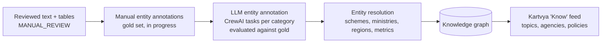

1. **Finish review tooling** so reviewers can clear documents at a steady rate, prioritising those with tables.
2. **Grow the gold annotation set** across ministries and categories.
3. **Automate annotation** with the per-category tasks drafted under `prompts/`, measured against the gold set.
4. **Resolve entities** to canonical nodes: a scheme mentioned in 400 answers is one node with 400 statements.
5. **Build the graph** and expose it to the product.

---

## 12. Operating the system

### Setup

```bash
npm install                          # Express server, scripts, Temporal workers
uv sync --extra dev                  # Python environment from the lockfile
```

On an Intel Mac the locked torch build has no wheel. Install everything else with `uv sync --extra dev --no-install-package torch`; the CLI, API, reports, and LLM extraction all work without it. Only local extraction (Marker) needs torch, and that stage has already been run across the data.

Keys go in `.env` as `GEMINI_API_KEY` plus any number of `GEMINI_API_KEY_<n>`; gaps in the numbering are fine. `GEMINI_MODEL` overrides the default vision model when a larger tier is wanted and responsive.

The UI lives in the sibling `ui.pipeline.knowledge-graph` repository and expects Express on 1337 and FastAPI on 8001.

### Run

```bash
npm run start:api-ts                 # Express file and annotation server on :1337
npm run start:api-py                 # FastAPI review and extraction endpoints on :8001
npm run start:cli                    # interactive CLI: extraction, table fixing, reports
cd ../ui.pipeline.knowledge-graph && yarn dev    # UI on :3000
```

### A walk through the system with real data

1. **Reports** in the CLI: pick a session and ministry, show the status overview. Every document is at LOCAL_EXTRACTION; the table columns come from Camelot.
2. **Ministry page** in the UI: `/ministry?loksabha=18&session=iv&ministry=health-and-family-welfare`. Filter by state and by "has tables"; the filters round-trip through the URL.
3. **LLM table extraction** on one document, from the CLI "Fix Tables" menu or with the API:

   ```bash
   curl -X PATCH -H 'Content-Type: application/json' \
     -d '{"document_path": "18/iv/ministries/health-and-family-welfare/u-3452"}' \
     http://127.0.0.1:8001/api/knowledge-graph/llm-extraction
   ```

   Open the document's `question.progress.json` afterwards: a new LLM_EXTRACTION entry is appended, and a retry appends another rather than overwriting.
4. **Review** in the UI's document pipeline page, or with the API: a save through `cleaned-data` moves the document into MANUAL_REVIEW with the edit recorded per page.
5. **Annotation workbench** at `/annotate`: open `s-64`, the one document with manual entity annotations, and step through the categories.

Commit data changes per ministry in the session's data repository, then update the submodule pointer in the parent.

---

## Glossary

- **Sansad / Lok Sabha number.** The elected term, e.g. 17th or 18th Lok Sabha.
- **Session.** A sitting period within a term, numbered in Roman numerals.
- **Starred question.** Answered orally in the House; prefix `s-`, PDF prefix `AS`.
- **Unstarred question.** Answered in writing; prefix `u-`, PDF prefix `AU`.
- **Ministry.** The answering ministry; one folder per ministry per session, about 55.
- **Document.** One question's PDF and everything derived from it.
